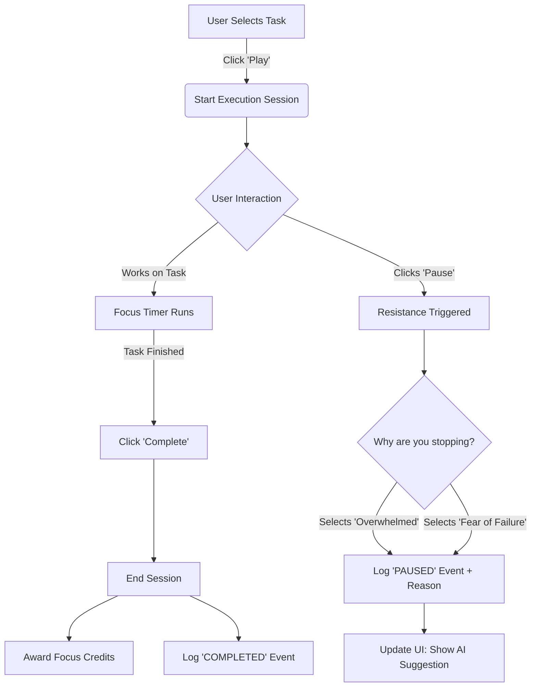
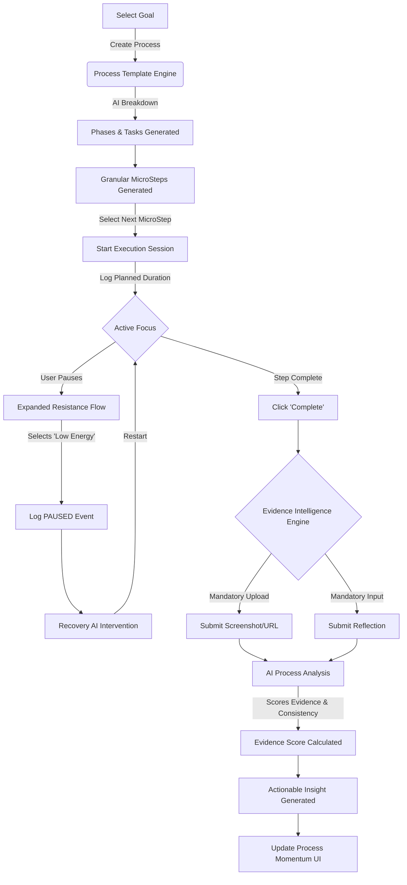

# TIMEFLOW: MASTER DOCUMENT
*Consolidated Project Research, Architecture, and Implementation Plan*

---

# PART 1: PROJECT RESEARCH & PLANNING

## Idea & Concept  
TimeFlow is positioned as an **AI Execution Continuity System** – not a simple to-do list. The core insight is that procrastination is *not* laziness but an emotional/psychological hurdle. Rather than organizing tasks, TimeFlow aims to help users overcome momentary resistance so they can *start, continue, and finish* important long-term goals. In other words, TimeFlow’s mission is to **“reduce the gap between intention and execution.”** It does this by detecting why a task is being avoided and guiding the user with micro-actions, process roadmaps, and momentum-recovery nudges. This is inspired by research like UCSB’s “science of starting,” which shows that brief reflection and breaking tasks into tiny steps can dramatically boost the chance of action.  

## Research: Psychology & Competitors  
**Execution Psychology:**  Modern studies confirm procrastination stems from *emotion regulation* issues, not weakness. When a task feels threatening, the brain triggers stress and avoidance. Conversely, **psychological momentum** – the perception of progress – is a key driver of sustained effort. If a user loses momentum, motivation drops and tasks stall. Research suggests that *“success breeds success, while failure breeds failure”*.  Therefore, TimeFlow’s design must focus on creating and sustaining momentum (e.g. via small wins and positive feedback) rather than simply issuing reminders.  
**Breaking the “Starting Line”:** UCSB researchers found that a 2-minute guided reflection, coupled with a quick micro-task, makes beginning a task much easier. Their Dawdle AI app turns this into a practical tool: it asks users what they’re avoiding, generates tiny subtasks, and encourages a small reward for completion. These findings support features like TimeFlow’s micro-step generator and “focus credits” (rewards): pairing effort with a small reward makes starting feel worthwhile. Indeed, “learned industriousness” theory holds that when effort is paired with reinforcement, effort itself becomes rewarding.  
**Competitor Landscape:** Several apps address parts of the problem but none cover the full scope. For example, *Liven* targets emotional procrastination by combining mood tracking, CBT-based courses, and an AI companion. *Forest* gamifies focus with virtual trees. Traditional tools like Todoist or Notion handle *organization*, but they lack behavioral insights. Dawdle AI (academic spin-off) provides AI-driven nudges for specific procrastination reasons. Most offerings either focus on scheduling/organization or single aspects of behavior; TimeFlow’s goal is to integrate **process roadmaps, resistance detection, momentum tracking, and adaptive guidance** into one ecosystem.  
**Behavioral Data & Privacy:** First-party behavioral data (the logs of how users interact) is the system’s most valuable asset. Such data, when analyzed, “enables companies to build better products and experiences”. TimeFlow’s architecture must collect execution events (start, pause, ignore, etc.) to fuel AI and analytics while respecting user privacy. Given regulations like GDPR/CCPA, we will treat behavioral logs as personal data: the privacy policy must disclose data categories (including behavioral data) and retention policies. Users will consent to data collection, and data usage will be transparent. By adhering to first-party data principles, we ensure users control their own data.

---

# PART 2: SYSTEM ARCHITECTURE (Current State)

## 1. Executive Summary
**TimeFlow** is not a standard task manager. It is designed as a **Behavioral Execution System** to aggressively reduce procrastination, manage dopamine patterns, and force user action through real-time interventions, visual urgency, and behavioral analytics.

## 2. Core Infrastructure (The Stack)
- **Frontend**: Next.js 14 (App Router), React, Tailwind CSS v3, Shadcn UI, Framer Motion, Socket.io-client.
- **Backend**: Node.js, Express.js (ESM), Socket.io, JWT Authentication.
- **Database**: PostgreSQL (managed via Prisma ORM).
- **Background Tasks**: node-cron (Currently transitioning to Redis + BullMQ for scalable queues).

## 3. Current Frontend Application (Features Implemented)

### A. Auth & Onboarding System
- **Routes**: `/signup`, `/login`, `/onboarding`.
- **Functionality**: Secure JWT authentication. During onboarding, users select an "Industry" (Tech, Health, Finance, etc.). This instantly alters the global CSS color palette to match their domain.

### B. Core Dashboard (`/dashboard`)
- **Execution Timer**: A live component that scans the database for the nearest upcoming task deadline. It counts down by the second. When it drops below 5 minutes, it pulses blue. At 00:00, it triggers the Web Audio API to play an 880Hz intervention beep.
- **Live Sync**: Connected via WebSockets to instantly reflect changes without refreshing.

### C. Task Management (`/tasks`)
- Standard CRUD operations. Enforces "Reason-Based" entry so users must justify *why* a task is important.

### D. Goal Management (`/goals`)
- Manual progress tracking (0-100%) for macro-level horizons (Weekly, Monthly, Yearly).

### E. Alarms Control Center (`/alarms`)
- **Task Triggers**: A read-only view of all tasks with upcoming deadlines, featuring live countdowns.
- **Manual Alarms**: A UI to set and toggle persistent daily times (e.g., 07:00 AM) completely separate from task deadlines.

### F. Knowledge Base (`/notes`)
- A non-linear, masonry-grid layout for capturing unstructured thoughts. Supports pinning to force critical data to the top.

---

# PART 3: FUTURE IMPLEMENTATION & ROADMAP

> **"An AI-powered Execution & Process Intelligence System that helps users start, continue, and complete important long-term work they keep postponing."**

*Architectural Directive: We are building a Behavioral Intelligence Engine, not a to-do app. The core value is Behavioral Execution Data. The system must reduce action resistance, provide process clarity, and maintain momentum without toxic pressure or generic AI wrappers.*

## 🚀 Development Execution Strategy

### ✅ PHASE 1: Core Infrastructure (Foundation)
*Goal: Establish the robust, reliable base layer required for a production-grade SaaS.*
- **Auth & Security:** Robust authentication flow.
- **Database Architecture:** Deploy PostgreSQL via Prisma.
- **Task & Session Models:** Basic CRUD for goals, tasks, and execution sessions.
- **Real-Time Engine:** Establish WebSocket connections for live syncing.

### 🧠 PHASE 2: Behavioral Systems (The Engine)
*Goal: Build the data-gathering mechanisms that track execution friction and momentum.*
- **Resistance Tracking:** UI flows to capture *why* a task is delayed (Overwhelm, Fear, Unclear Start).
- **Execution Event Logging:** Store immutable logs of all micro-behaviors (task creation, start, pause, ignore).
- **Momentum Engine:** Algorithm to calculate current momentum state (Rising, Stable, Dropping) based on recent event velocity.
- **Process Tracking Models:** Database schemas to support multi-stage workflows and long-term journey mapping.

### 🤖 PHASE 3: AI Execution Layer (The Intelligence)
*Goal: Connect LLMs to our behavioral data to provide adaptive, context-aware execution support.*
- **AI Micro-Step Generator:** Service to automatically break down high-resistance tasks into zero-friction actions.
- **Process Roadmap Generator:** AI generation of structured, multi-phase execution paths for complex goals.
- **Adaptive Reminder Engine:** Context-aware notifications that change tone and strategy based on the user's identified Resistance Type and Momentum State.
- **Execution Recovery Guidance:** Non-punitive AI interventions designed to restart momentum after a collapse.

### 📊 PHASE 4: Analytics & Intelligence (The Value)
*Goal: Show the user their behavioral reality and process insights.*
- **Execution Analytics Dashboard:** Visualizing consistency, delay patterns, and completion velocity.
- **Process Insights:** Data on where users typically stall within multi-stage processes.

---

# PART 4: THE PROCESS INTELLIGENCE PIVOT

## 1. The Core Pivot: Process Intelligence > Gamification
The ultimate value of TimeFlow does not come from points or social leaderboards. The value comes from answering one critical question:
**"Where exactly is this person in their journey, why are they stuck there, and what is the smallest next action that will realistically move them forward?"**

Consequently, development on "The Arena" (social leaderboards) and gamified "Focus Credits" is heavily de-prioritized. The system will now pivot exclusively to **Process Intelligence** and deep behavioral tracking.

## 2. Structural Changes: The Hierarchy
The new enforced hierarchy is:
`Goal` ➔ `Process` ➔ `Phase` ➔ `Task` ➔ `Micro-Step`

*   **Process Templates**: The system will support pre-built templates (e.g., "Learn React", "UPSC Preparation") that automatically populate Phases and Tasks.
*   **Micro-Step State**: Micro-steps will no longer be simple JSON checkboxes. They will be tracked entities to calculate precise momentum (`Task -> MicroStep 1 ✅ -> MicroStep 2 ⏳`).

## 3. Execution Session Enhancement
Execution Sessions must capture deeper behavioral reality. When a session ends, it will capture:
*   Planned duration vs. Actual duration
*   Focus rating (User self-reported)
*   Energy level
*   Difficulty 
*   Completion quality

## 4. Resistance & Reflection Systems
*   **Expanded Resistance**: `OVERWHELMED`, `FEAR`, `DISTRACTED` are expanded to include: `LOW_ENERGY`, `WAITING_FOR_SOMEONE`, `MISSING_INFORMATION`, `TOO_DIFFICULT`, `LOST_INTEREST`, `PERSONAL_ISSUE`, `HEALTH_ISSUE`, `CHANGED_PRIORITY`, and `CUSTOM`.
*   **Reflection Layer**: Completing a task prompts specific reflective questions: *What went well? Biggest challenge? What would you change next time? Next action?*

## 5. AI Specialization & Memory
*   **Modular AI**: No single "Generic AI". We will route specific tasks to specific agents: `Roadmap AI`, `Micro-Step AI`, `Reflection AI`, `Recovery AI`, `Evidence AI`, `Process AI`.
*   **AI Memory**: The AI will store and query previous blockers, advice given, and past mistakes to ensure continuity of coaching.

---

# PART 5: EVIDENCE INTELLIGENCE ENGINE (EIE)

### 1. Technical Design Overview
The Evidence Intelligence Engine (EIE) is a critical subsystem designed to capture, structure, and analyze the artifacts of user execution. Instead of acting as an authoritarian truth-detector, the EIE serves as a contextual data pipeline for the AI Layer. By collecting progress updates, reflections, and attachments during an `ExecutionSession`, the EIE calculates an `EvidenceScore` (confidence metric). This allows the AI to provide highly contextualized behavioral insights, process adjustments, and momentum nudges based on the *quality and consistency* of the evidence provided, rather than a binary true/false judgment.

### 2. Implementation Plan
- **Frontend Expansion**: Expand the Task Details page into an active workspace with a real-time progress timeline (similar to a PR timeline).
- **Input Forms**: Add fields for Progress (0-100%) and Reflections.
- **Evidence Upload**: Support files, URLs, GitHub repos, documents, videos, etc., as Proof of Work.
- **AI Analysis**: Calculate confidence metrics based on evidence provided (never accuse the user of lying).
- **Security**: Strict privacy controls on uploaded evidence, securely handled via pre-signed URLs.

---

# PART 6: SYSTEM FLOW ARCHITECTURE

## 1. Current Workflow (Behavioral Event System)
This diagram illustrates how the system currently handles a task execution session and captures early behavioral data (resistance tracking).

## 2. Upcoming Workflow (Process Intelligence + EIE)
This diagram illustrates the upcoming architectural state. Notice the shift from simple task completion to a structured "Process Journey" requiring Proof of Work and Reflection.

